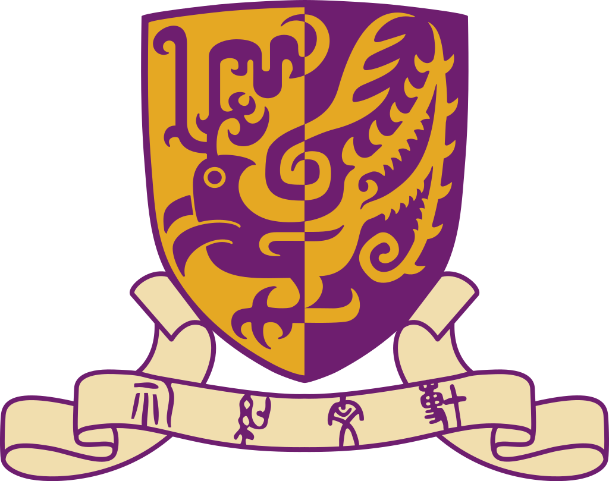

## Welcome to my page! 👋

Hi, I am **Yuhao**. I am an MPhil student in Computer Science at **The Chinese University of Hong Kong, Shenzhen**, advised by Prof. Juexiao Zhou.

My research focuses on **AI for Healthcare**, with the goal of building trustworthy clinical AI systems. My interests include:

- **Medical LLMs and agents:** clinical decision support and verifiable diagnostic reasoning.
- **Trustworthy and explainable AI:** improving reliability, transparency, and fairness in healthcare.
- **Multimodal medical foundation models:** integrating medical images, text, and other clinical data.

🌐 Find out more about me and my research on my [personal website](https://yuhos16.github.io/).
